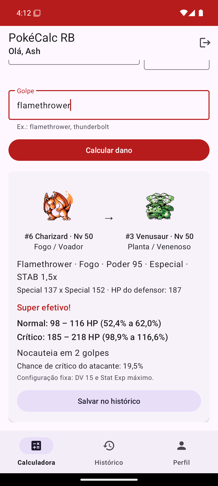
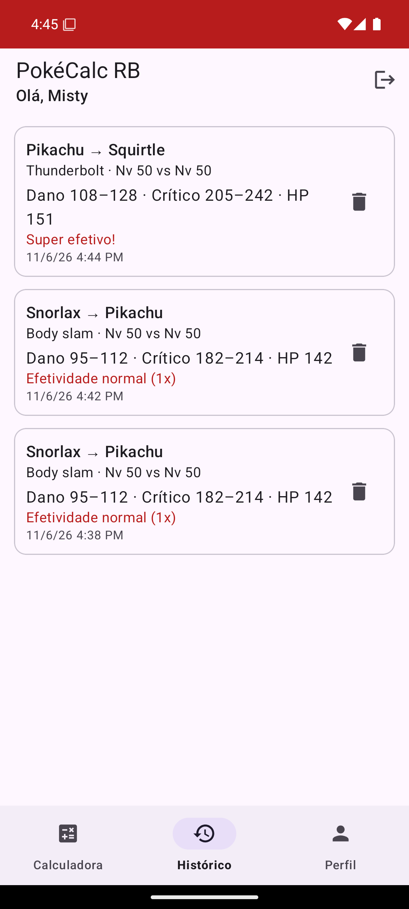
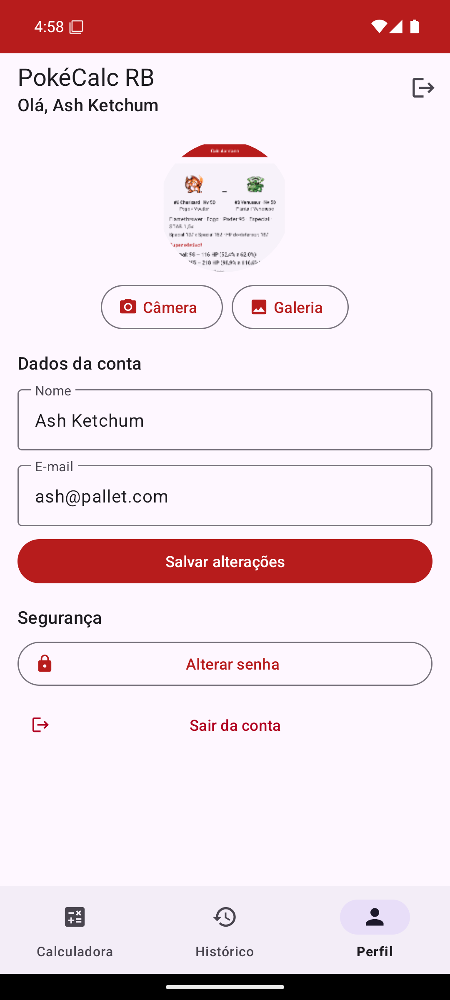
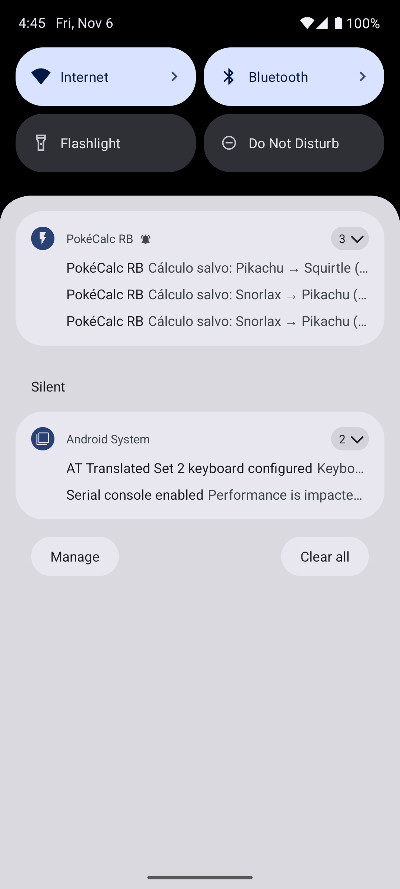

# PokéCalc RB

Calculadora de dano da **Geração 1** de Pokémon (Red/Blue/Yellow) para Android, feita em **Java**.
Trabalho da Avaliação 3 de Programação Mobile.

Você escolhe o Pokémon atacante, o defensor (#1 a #151), os níveis e um golpe. O app busca os dados na [PokéAPI](https://pokeapi.co/) e mostra:
- o dano mínimo e máximo, com e sem acerto crítico;
- a porcentagem do HP do defensor;
- quantos golpes são precisos para nocautear;
- a efetividade do tipo.

Os cálculos podem ser salvos num histórico pessoal.

<p align="center">
  
  
  
  
</p>

## Funcionalidades

- **Conta:** cadastro e login, com a senha guardada como **hash BCrypt com salt**. A sessão continua depois de fechar o app, e há logout.
- **Calculadora:** fórmula oficial da Gen 1, incluindo STAB, crítico, a regra do 255 e a tabela de tipos da época (com os "bugs", como Fantasma × Psíquico = 0×). Os campos de Pokémon e golpe têm autocompletar.
- **Dados reais da Gen 1:** o app usa `past_types`, `past_stats` e `past_values` da PokéAPI. Assim, Magnemite é só Elétrico, Bite é Normal e Clefairy é Normal.
- **Funciona offline:** cada Pokémon e golpe consultado fica guardado no banco (Room), então dá para calcular de novo sem internet.
- **Histórico:** cada usuário vê e apaga só os próprios cálculos.
- **Notificação** ao salvar um cálculo. Tocar nela abre o Histórico.
- **Perfil:** troca de nome, e-mail e senha. A foto de perfil pode vir da **câmera** ou da **galeria**.
- **Tela de abertura** com a Splash Screen API.

## Como rodar

### Instalar o APK pronto

Copie o [`PokeCalcRB.apk`](PokeCalcRB.apk) para um celular ou emulador com Android 8.0 ou mais novo e instale. Para as notificações, use Android 13 ou mais novo.

### Compilar pelo Android Studio

1. No Android Studio, abra a pasta **`PokeCalcRB`** com **File > Open**.
2. Espere o *Gradle Sync* terminar. Na primeira vez ele baixa as dependências, então precisa de internet.
3. Clique em **Run** com um emulador ou celular conectado.

Pela linha de comando, dentro de `PokeCalcRB`:

```bash
./gradlew assembleDebug
```

O APK sai em `PokeCalcRB/app/build/outputs/apk/debug/app-debug.apk`.

## Testes

- **Unitários (JUnit):** testam a fórmula, a tabela de tipos e as regras da Gen 1. O arquivo é `PokeCalcRB/app/src/test/java/br/ufms/pokecalcrb/domain/CalculadoraGen1Test.java`. Para rodar:

  ```bash
  ./gradlew test
  ```

- **Caixa-preta:** são 43 casos, todos aprovados no emulador Android 15. A tabela com o resultado de cada caso está na seção 11 da [especificação](docs/ESPECIFICACAO.md). Os prints de cada caso estão em [`docs/prints`](docs/prints).

## Documentação

[`docs/ESPECIFICACAO.md`](docs/ESPECIFICACAO.md) é o documento de especificação. Ele traz papéis de usuário, requisitos funcionais e não funcionais, modelo de dados, telas, a fórmula e os testes.

## Tecnologias

| Área | O que foi usado |
|---|---|
| Linguagem e plataforma | Java 11 · Android SDK 35 (mínimo 26) · Gradle 8.9 / AGP 8.7 |
| Interface | Material 3 · AppCompat · Splash Screen API · BottomNavigation |
| Arquitetura | ViewModel + LiveData · Repositórios |
| Banco local | Room 2.6.1, com 4 tabelas: `usuarios`, `calculos` (chave estrangeira para o usuário), cache de Pokémon e cache de golpes |
| Rede | Retrofit 2.11 + Gson · OkHttp 4.12 |
| Imagens | Glide 4.16 (sprites) · FileProvider (câmera) · Photo Picker (galeria) |
| Segurança | `at.favre.lib:bcrypt` 0.10.2 (custo 10) |

## Estrutura

```
PokeCalcRB/app/src/main/java/br/ufms/pokecalcrb/
├── PokeCalcApp.java          cria o canal de notificação
├── domain/                   Java puro, testável: fórmula Gen 1 e tabela de tipos
├── data/
│   ├── db/                   Room: entidades e DAOs
│   ├── api/                  Retrofit, DTOs e ConversorGen1 (dados da Gen 1)
│   └── repo/                 Repositórios (cache → API) e sessão
├── security/                 SenhaHasher (BCrypt)
├── ui/
│   ├── auth/                 Login e Cadastro
│   ├── main/                 MainActivity (Splash + navegação)
│   ├── calc/                 Calculadora
│   ├── historico/            Histórico
│   └── perfil/               Perfil (câmera, galeria, senha, logout)
└── util/                     Validação, notificações, nomes para o autocompletar
```

## Equipe

| Nome |
|---|
| _[preencher]_ |
| _[preencher]_ |
| _[preencher]_ |

---

Pokémon e os nomes relacionados são marcas da Nintendo, Game Freak e Creatures. Este é um projeto acadêmico sem fins comerciais. Os dados vêm da PokéAPI.
